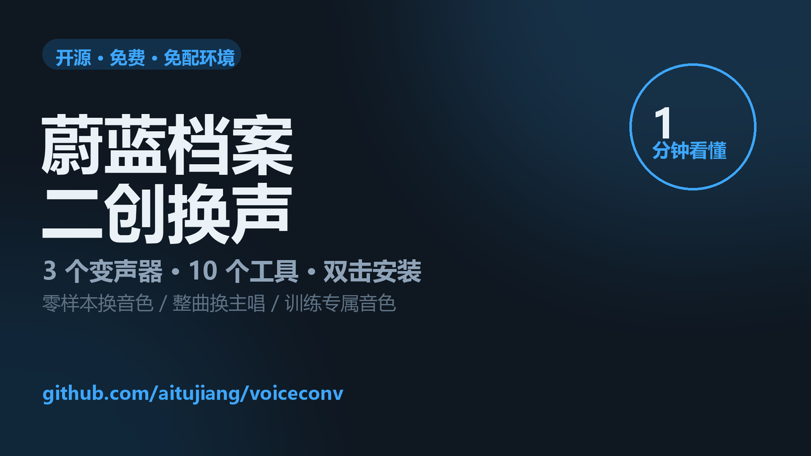

# 素材工具箱



一站式二创素材工具箱：把「找素材 → 处理 → 出成品」串成一条线。
**10 个工具**收在一个界面，**三套 AI 声音引擎**本地运行，装好后不联网也能用。

▶ **1 分钟演示**：<https://www.bilibili.com/video/BV12Sn36cE8j>

## 三步开始

| 步 | 做什么 |
|---|---|
| 1 | 下载本仓库（绿色 `Code` → `Download ZIP`），解压到任意目录 |
| 2 | 双击 **`安装.bat`** —— 不用先装 Python，它会自己装 |
| 3 | 双击 **`启动.bat`** |

升级时双击 `升级.bat`。要求：Windows 10/11 64 位、NVIDIA 显卡（建议 8 GB 显存）、
约 20 GB 磁盘。**全程不需要梯子。**

---

## 能做什么

### 素材获取

| 工具 | 说明 |
|---|---|
| 🎵 **音频提取** | 从视频里抽出音频，支持批量、三种输出格式 |
| 🎤 **人声分离** | 拆成人声 + 伴奏（Demucs），训练素材去 BGM 用 |
| 📊 **响度标准化** | 音量统一到平台标准（-14 LUFS 等），避免上传后被压 |
| 💬 **字幕识别** | 音视频转文字，输出 SRT + TXT（Whisper） |
| 🔗 **素材网站** | 常用素材站导航，可自己增删 |

### 声音处理

| 工具 | 说明 |
|---|---|
| 🎙 **AI 变声** | 换音色、整曲换主唱。零样本，给段参考音频就能用（Seed-VC） |
| 📚 **音色库** | 音色预设管理：素材 + 参数一起存，一键调用 |
| 📖 **AI 朗读** | 打字，用指定音色念出来（GPT-SoVITS） |
| 🎛 **RVC 变声器** | 训练专属音色模型，原版 WebUI |

### 外部软件

用户自己添加的 .exe / .bat / 文件夹，点一下启动。
适合把 ComfyUI、剪辑软件这些常用工具也收进来。

---

## 三种「换声音」的路线

这个工具箱里其实有三套不同的 AI 声音技术，各有适用场景：

| 需求 | 用什么 | 要训练吗 | 参考音频 |
|---|---|---|---|
| **快速试音色** | AI 变声（Seed-VC） | ❌ 零样本 | 需要，5~25 秒 |
| **固定角色长期用** | RVC | ✅ 训一次，永久用 | 不需要 |
| **只有文字没有人声** | AI 朗读（GPT-SoVITS） | ❌ 零样本，也可训练 | 需要 |

**它们不是替代关系，是互补的。** 而且**模型互不通用** ——
同一个角色要做「变声」和「朗读」，得分别准备。

---

## 系统要求

| 项目 | 要求 |
|---|---|
| 系统 | Windows 10 / 11，64 位 |
| 显卡 | **NVIDIA**，建议 8 GB 显存以上 |
| 磁盘 | 约 20 GB（含引擎和模型） |
| Python | **3.12**（64 位）· 3.10 / 3.11 也可以 |
| 内存 | 16 GB 建议 |

### ⚠️ 关于显卡

- **只支持 NVIDIA**。Seed-VC 和 GPT-SoVITS 依赖 CUDA，AMD 显卡跑不了。
- **RTX 50 系**（Blackwell / sm_120）需要 PyTorch 2.7+ 且带 cu128 内核。
  低版本 PyTorch 在这代卡上**装不上或跑不起来**。
- 显存小于 6 GB 时，训练类功能会很紧张。

### ⚠️ 关于 Python 版本

**请用 Python 3.12（64 位）**。

- 3.10 / 3.11 也能跑。
- **3.13 不行**：`funasr`、`pymss`、`opencc` 这些依赖还没有 3.13 的 Windows
  wheel，会装到一半失败。`setup.py` 在体检那一步就会拦住并提示。
- 机器上有多个 Python 时，用 `py -3.12 setup.py` 指定版本。

装 Python 时**务必勾选 `Add Python to PATH`**，装完敲 `python -V` 确认。


---

## 安装

### 快速方式（推荐）

解压本仓库，**双击 `安装.bat`** 即可，**不需要先装 Python**。

机器上没有 Python 3.10~3.12 时，它会自动下载 Python 3.12 并**只给当前用户**
静默安装（约 26 MB，不需要管理员权限），装完接着跑完整流程。
已经有 Python 时按顺序挑：已有的 `.venv` → `py -3.12` → PATH 上的
`python`（版本合适才用）。

等价的手工命令（想看到全部参数时用）：

```powershell
python setup.py
```

它会依次做这些事，**每一步都可以单独重跑**：

| 步骤 | 内容 |
|---|---|
| 0 | **体检** —— 读显卡型号、驱动版本、显存、磁盘，判断能不能装 AI 功能 |
| 1 | 下载 ffmpeg（约 100 MB） |
| 2 | 建 `.venv` 并按显卡装对应版本的 PyTorch |
| 3 | 装依赖（自动测速选最快的 pip 源） |
| 4 | 下载三套引擎（约 700 MB） |
| 5 | 下载模型权重（约 9 GB） |
| 6 | 建子环境 + 装各引擎自己的依赖 + 应用兼容修补 |

**几个有用的参数**：

```powershell
python setup.py --check          # 只体检，不改任何东西
python setup.py --core           # 只装核心（音频工具，不碰 AI）
python setup.py --step env       # 只跑某一步（失败后重试用）
python setup.py --yes            # 不交互，全自动
```

**中途断了怎么办**：重新跑 `python setup.py`，已完成的步骤会跳过。
想彻底重来，删掉 `logs\setup-state.json`。

---

### 手动方式（想自己控制每一步）

<details>
<summary>点开看完整手动步骤</summary>

#### 1. 检查显卡和驱动

```powershell
nvidia-smi
```

**记录驱动版本** —— 它决定能用哪个 CUDA：

| 驱动版本 | 最高 CUDA |
|---|---|
| ≥ 570 | 12.8（50 系必需） |
| 530 ~ 569 | 12.1 |
| 520 ~ 529 | 11.8 |

#### 2. 装 PyTorch

**50 系**（RTX 5060/5070/5080/5090）：
```powershell
python -m pip install torch==2.7.0 torchaudio==2.7.0 --index-url https://download.pytorch.org/whl/cu128
```

**40 系及更早**：
```powershell
python -m pip install torch torchaudio --index-url https://download.pytorch.org/whl/cu121
```

验证：
```powershell
python -c "import torch; print(torch.cuda.is_available(), torch.cuda.get_device_name(0))"
```

#### 3. 建环境并装依赖

```powershell
python -m venv .venv
.venv\Scripts\pip install -r requirements.txt --index-url https://mirrors.pku.edu.cn/pypi/simple
```

#### 4. 下载引擎

**用 zip，不要 git clone** —— `git clone github.com` 在国内经常连不上，
而 zip 能下（这也是 `setup.py` 的做法）：

```powershell
# 三个 zip，浏览器直接下：
#   https://github.com/Plachtaa/seed-vc/archive/refs/heads/main.zip
#   https://github.com/RVC-Boss/GPT-SoVITS/archive/refs/heads/main.zip
#   https://github.com/RVC-Project/Retrieval-based-Voice-Conversion-WebUI/archive/refs/heads/main.zip
#
# 解压后**去掉最外层那个 repo-main 目录**，把里面的内容放进：
#   src\seed-vc-main
#   tools\tts\engine
#   tools\rvc\engine
```

#### 5. 下载权重

```powershell
.venv\Scripts\python download_models.py
.venv\Scripts\python download_rvc_models.py
.venv\Scripts\python download_tts_models.py
```

#### 6. 建子环境

```powershell
.venv\Scripts\python -m venv --system-site-packages tools\tts\venv
.venv\Scripts\python -m venv --system-site-packages tools\rvc\venv
```

然后把 `.venv\Lib\site-packages` 的路径分别写进：
```
tools\tts\venv\Lib\site-packages\_shared_from_voice.pth
tools\rvc\venv\Lib\site-packages\_shared_from_voice.pth
```

</details>

### 7. 启动

```
双击  启动.bat
```

---

## 升级到新版本

**一键更新（推荐）**：先退出工具箱，然后双击 **`升级.bat`**。

它自动完成：从 GitHub 取最新代码 → 只覆盖代码文件（旧文件先备份到
`logs\code-backup\`）→ 跑一遍 `setup.py`，只装变化了的部分。你不用选目录、
也不用担心多出一层文件夹。

- 只想看看有没有新版：`python update.py --check`
- GitHub 连不上：自己下 zip，然后 `python update.py --zip 路径\voiceconv-main.zip`

**手动方式**（不用脚本）：解压新版本到临时目录，进入里面的
`voiceconv-main\`，全选复制，粘到**原来 `启动.bat` 所在的那一层**，
弹窗选「替换目标中的文件」。注意别让目录里多出一层 `voiceconv-main\`。

两种方式都只动代码：`.venv` / 引擎 / 权重 / 你的成品 / 音色预设都不动。
素材网站列表存在 `data\sites.local.json`，也不会被覆盖。
升级前**先退出工具箱**，否则文件被占用会失败。

---

## 只想要音频工具？

如果只用「音频提取 / 响度标准化 / 素材网站」这三个，
**不需要装 PyTorch 和任何引擎** —— 它们只依赖 ffmpeg：

1. 下载 [ffmpeg](https://www.gyan.dev/ffmpeg/builds/)，把 `ffmpeg.exe` 和
   `ffprobe.exe` 放进 `bin\` 目录
2. 双击 `启动.bat`

这三个工具在纯 CPU 机器上也能跑。

---

## 快速上手

### 换一个声音

1. 点「🎙 AI 变声」
2. ① 选要变声的音频
3. ② 选音色参考音频（5~25 秒干净人声）
4. 点「存为预设」起个名字 —— 以后不用再找素材
5. 点「开始变声」

首次要加载模型（1~3 分钟），之后每次约 15 秒。

### 整首歌换主唱

1. 点「🎙 AI 变声」
2. 选音色 → 选整首歌
3. 类型选「整曲换人声（保留伴奏）」
4. 它会自动做三步：分离人声 → 变声 → 混回伴奏

**人声盖住伴奏时**：调低「人声增益」（默认 1.0，试 0.55）。

### 训一个专属音色

1. 素材放 `data\datasets\<角色名>\`（5~10 分钟同角色人声）
2. 点「🎛 RVC 变声器」→ 启动 RVC
3. 在 WebUI 的训练页操作：填实验名 → 一键处理数据 → 特征提取 → 训练 → 训练特征索引
4. 训练完，模型会出现在 RVC 的模型下拉里

详细参数见 [`训练素材要求.md`](训练素材要求.md)。

---

## 项目结构

```
voiceconv\
├── 启动.bat                  入口
├── 安装.bat                  一键安装（挑解释器 + 跑 setup.py）
├── 升级.bat                  一键更新（取最新代码 + 跑 setup.py）
├── update.py                 更新逻辑
├── launcher.py               工具箱主界面
├── oneclick.py               AI 变声
├── convert.py                单条变声（命令行）
├── song.py                   整曲换主唱（分离+变声+混音）
├── prepare_dataset.py        训练数据准备（切片 + Whisper 自动标注）
├── train_model.py            GPT-SoVITS 训练流水线
├── download_*.py             模型权重下载
├── shared\                   共用模块
│   ├── paths.py              路径定义 + 子环境路径自愈
│   ├── theme.py              配色和字体
│   ├── presets.py            音色预设
│   ├── links.py              外部软件列表
│   ├── vram.py               显存监控
│   ├── training_spec.py      训练素材要求（单一事实来源）
│   ├── tools_registry.py     工具注册表
│   └── opener.py             打开文件/网址（多级回退）
├── tools\                    各工具的界面
│   ├── audio\                音频提取 / 人声分离 / 响度 / 字幕
│   ├── voice\                变声 / 音色库
│   ├── tts\                  AI 朗读
│   ├── rvc\                  RVC 入口
│   └── sites\                素材网站
├── data\                     配置（预设、网站列表）
├── io\output\                所有成品
├── bin\                      ffmpeg
├── src\                      Seed-VC 引擎（需自行下载）
└── models\                   权重缓存
```

---

## 技术说明

### 三个 Python 环境共用一份 PyTorch

变声、朗读、RVC 各自需要不同版本的依赖（比如 GPT-SoVITS 要
`transformers 4.57`，RVC 要 `4.49`，两者不能共存）。

所以做了三个虚拟环境。但 **PyTorch 有 5.4 GB**，装三份太浪费 ——
后两个环境用 `--system-site-packages` + 一个 `.pth` 文件指向
`.venv` 的包目录，这样它们能看见 torch，但自己装的包不会污染回去。

### 子环境路径自愈

上面的做法有个副作用：`.pth` 和 `pyvenv.cfg` 里写死了 `.venv` 的绝对路径。
项目一旦改名或移动，「变声/朗读/RVC」会全部报错，而界面上看不出原因。

`shared/paths.py` 里的 `fix_venv_paths()` 会在每次启动时检查并修正这两处，
所以**改名、移动、换盘符都能正常用**。

### 显存管理

三个 AI 工具都要吃显存，而显存是**按进程隔离**的。

- 启动器底部常驻显示整卡占用（读 `nvidia-smi`，能看到所有进程）
- 每个工具内部有「释放显存」按钮，只释放**自己进程**的
- 关闭工具时自动释放
- 训练前会按显存给出 batch size 建议

---

## 常见问题

### 装了 PyTorch 但 `torch.cuda.is_available()` 是 False

大概率装成了 CPU 版。查一下：
```powershell
python -c "import torch; print(torch.__version__)"
```
带 `+cpu` 就是 CPU 版，卸载重装 [正确的 CUDA 版](https://pytorch.org/get-started/locally/)。

### `PermissionError: [WinError 5] ... .cache\huggingface`

模型缓存目录没写权限。代码里已经把 `HF_HOME` / `TORCH_HOME` 指到项目内，
如果还报错，手动设环境变量：
```powershell
set HF_HOME=D:\你的路径\voiceconv\models\hfcache
set TORCH_HOME=D:\你的路径\voiceconv\models\torch
```

### 变声出来的声音不像

1. **参考音频质量最关键** —— 5~25 秒、干净、无 BGM
2. 换「说话·更像参考」模式
3. 调「音色相似度」（越高越像，但可能不自然）
4. 用 RVC 训练专属模型，效果通常更好

### 整首歌里人声太响，盖住伴奏

变声后的人声可能比原来响 6~9 dB。调低「人声增益」到 0.5~0.6。

### 训练时爆显存

调小 batch size：
```powershell
python train_model.py --character 角色名 --batch-gpt 4 --batch-sovits 2
```
已完成的步骤会自动跳过，不用从头来。

### 显卡是 AMD，能跑吗

**不能。** 变声和朗读依赖 CUDA。纯音频工具（提取 / 响度 / 素材网站）可以，
但那三个本来也不需要 GPU。

---

## 依赖的开源项目

这个项目本身只做整合和界面，所有 AI 能力都来自下面这些项目：

| 项目 | 用途 | 许可证 |
|---|---|---|
| [Seed-VC](https://github.com/Plachtaa/seed-vc) | 零样本变声 | **GPL-3.0** |
| [GPT-SoVITS](https://github.com/RVC-Boss/GPT-SoVITS) | 语音合成 | MIT |
| [RVC](https://github.com/RVC-Project/Retrieval-based-Voice-Conversion-WebUI) | 训练式变声 | MIT |
| [Demucs](https://github.com/facebookresearch/demucs) | 人声分离 | MIT |
| [Whisper](https://github.com/openai/whisper) | 语音识别 | MIT |
| [FFmpeg](https://ffmpeg.org) | 音视频处理 | LGPL / GPL |

本仓库**不包含**上述项目的代码和模型权重，需要按安装步骤自行下载。

---

## 许可证

[GPL-3.0](LICENSE)。

采用 GPL-3.0 是因为核心功能依赖 Seed-VC（GPL-3.0），
按 GPL 的传染性，本项目也需要使用同一许可证。

---

## 免责声明

本项目仅供个人学习与创作使用。使用他人声音训练模型、或生成模仿他人
的内容时，请自行确认素材授权与当地法律法规。生成内容的相关责任由使用者承担。
